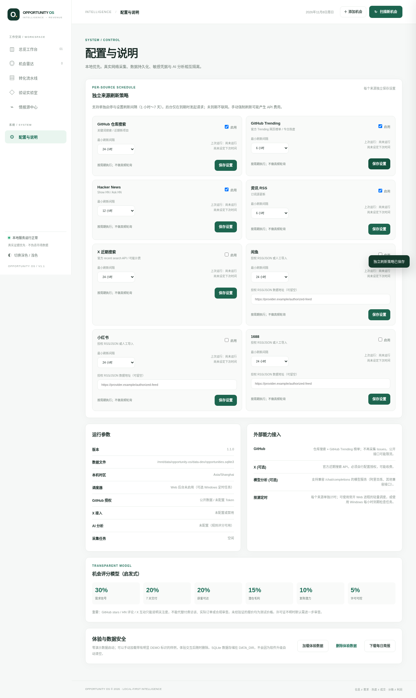

# Opportunity OS V1.1 — 机会发现、授权平台数据接入与独立刷新调度

> 一套可本地运行的 FastAPI + SQLite + 原生 Web 工作台。持续发现技术与市场信号，形成可验证的商业假设，再记录实际咨询、试单、订单和成本。**不会将热点、星标、平台商品出现或模型推断当作真实付费需求。**
>
> 版本：2026-11-08 / V1.1。**在 V1.0 基础上升级**，不删旧机会、实验、快照、RSS、关键词等数据。



## Windows 一键启动

1. 安装 Python 3.10+；将 ZIP 解压到 `D:\aiTools\opportunity-os`（目录可自定）。
2. 双击 `run_windows.bat`。首次安装需要访问 PyPI，依赖包含 BeautifulSoup4，用于解析 GitHub Trending 官方网页。服务地址：`http://127.0.0.1:8767`。
3. 打开「配置与说明 → 独立来源刷新策略」，逐站调整“启用”以及 1 小时、3 小时、6 小时、12 小时、24 小时、48 小时、7 天的刷新间隔，点击每张卡的「保存设置」。
4. 在「情报源中心」点击「立即采集」只拉取**已经到期**的来源；单个来源「强制刷新」才会忽略间隔（可能产生 API 费用）。
5. 「机会雷达」筛选 `GitHub Trending`、`闲鱼`、`小红书`、`1688`，点击结果可查看原始链接、商业假设和测试报价。

### 从 V1.0 安全升级

1. 原项目先运行 `backup_windows.bat`，将 `.env` 和数据目录另行备份。
2. 覆盖更新 `app/`、`tests/`、`docs/`、`requirements.txt` 和启动/任务脚本。**不要用新包覆盖自己的 `.env`、`data/` 或外部 `DATA_DIR`**。新 ZIP 默认不含业务数据库。
3. 再次执行 `run_windows.bat` 安装新增依赖；启动时自动新增 `source_configs` 表，不修改原机会和实验表。
4. V1.0 的 GitHub Issue 数据**保留历史记录**以避免丢失证据，但不再出现在新采集器或默认来源过滤选项；如不需要可以手工归档。
5. 如果以前已经安装 `Opportunity OS Daily Scan` 任务，建议在 Windows 任务计划程序中禁用旧任务，再安装新版本的到期检查任务，避免重复触发。

### 数据目录

在 `.env` 中设置：

```dotenv
HOST=127.0.0.1
PORT=8767
DATA_DIR=E:\stockData\opportunity-os
TIMEZONE=Asia/Shanghai
AUTO_SCAN=1
SCAN_DAYS=14
GITHUB_TOKEN=
X_ENABLED=0
X_BEARER_TOKEN=
X_QUERY=("AI agent" OR "MCP") -is:retweet lang:en
LLM_BASE_URL=
LLM_API_KEY=
LLM_MODEL=
```

> `SCAN_TIME` 是旧版配置，V1.1 不再使用。各来源的开关和刷新频率保存在 `DATA_DIR/opportunities.sqlite3` 内，**不需要每次修改 `.env` 或重启**。只有修改 `.env` 凭据、监听地址或数据目录后才需要重启。

## 本轮新增与修改

| 来源 | 方式 | 默认启用 | 默认刷新间隔 | 需要准备的授权 |
|---|---|---:|---:|---|
| GitHub 仓库搜索 | GitHub 官方仓库 REST 搜索 | 是 | 24 小时 | Token 非必需；建议配置降低限流 |
| **GitHub Trending** | 官方 `https://github.com/trending` HTML 榜单 | 是 | **12 小时** | 不要求 Token；页面改版可能导致解析失败 |
| Hacker News | 官方 Firebase API | 是 | 12 小时 | 无 |
| 资讯 RSS | 用户配置的 RSS/Atom 地址 | 是 | 6 小时 | 对应公开发布源 |
| X 最近搜索 | 官方 API | 否 | 24 小时 | 自己的官方 Bearer Token，可能计费 |
| **闲鱼** | 获授权 RSS/JSON 适配器或 CSV/JSON 导入 | 否 | 24 小时 | 授权数据提供方 / 合规人工资料 |
| **小红书** | 获授权 RSS/JSON 适配器或 CSV/JSON 导入 | 否 | 24 小时 | 授权数据提供方 / 合规人工资料 |
| **1688** | 获授权 RSS/JSON 适配器或 CSV/JSON 导入 | 否 | 24 小时 | 阿里开放平台适用业务权限 / 合规人工资料 |
| **GitHub Issues** | **不再采集** | — | — | — |

刷新频率的作用是**限制最短再次拉取时间**，不代表各站都提供实时事件订阅。所有外部请求失败会保留上次成功数据，并在来源中心显示真实错误。未到期的站点不会发起网络请求。

### GitHub Trending 特别说明

- 抓取的是 GitHub 官方 Trending 网页公开展示的仓库条目，保留仓库名称、原链接、简介、语言、当期新增 Stars（有则解析）。
- **页面入榜时间不等于仓库创建时间**。初次采集不会凭空编造仓库创建日期、许可证或真实销售额。
- GitHub 网站结构变动或限制访问时会明确显示失败，不自动回退到随意的第三方“热门榜单”。
- [GitHub Trending](https://github.com/trending)

## 闲鱼 / 小红书 / 1688 的真实接入方式

对这三站，V1.1 **不是免授权全站爬虫**。普通 GitHub/API 访问能力不等于有权获取平台站内所有搜索结果、商品、订单、笔记、价格和互动数据。为保护账号和数据合法性，系统不会模拟登录、破解风控、绕验证码或使用盗用 Cookie。

**方式 A — 合法数据源定期同步（自动）**

向授权数据商或自有服务商 API 申请对应可用的查询/导出服务。通过你自己的适配层将响应转换为下面的 JSON 或 RSS，然后在「配置与说明」的对应平台卡填写一个**公网 HTTPS 授权数据地址**，启用并保存。适配层应自行管理密钥与授权，不要把密钥写进 URL 或导入文件。系统不会在配置缺失时声称已完成平台数据抓取。

JSON 格式示例（只是协议格式样例，不是真实商品）：

```json
{
  "items": [
    {
      "id": "demo-item-id",
      "title": "平台公开商品或笔记标题",
      "url": "https://www.1688.com/your-actual-authorized-item-path",
      "summary": "从授权渠道取得的真实描述",
      "price": 199,
      "sales": 10,
      "shop": "供货商名称",
      "published_at": "2026-11-08T10:00:00+08:00"
    }
  ]
}
```

> 上面的 URL 仅表示字段形式，并不是一条真实或可访问的商品；替换为你有权取得的官方页面 URL。授权适配器响应只需提供**无密钥的必要字段**。系统拒绝明显的内网 URL、跨站伪造商品 URL、重定向和超过 3 MB 的响应；首次接入仍应由你审查数据来源的授权与服务条款。

**方式 B — CSV/JSON 批量导入（无需自动接口）**

前往「情报源中心」→「闲鱼 / 小红书 / 1688 · 机会监控」→ 选择站点 → 上传 CSV 或 JSON。CSV 至少需要 `title,url` 两列，另可填 `summary,price,sales,shop,published_at`；仅接受对应平台官方页面的 HTTPS URL。单次最多 200 条、文件大小不超过 500 KB。系统自动去重，并在来源、详情和机会雷达中保留出处。

导入数量不等于真实成交或库存；价格、销量必须逐条核查，不可直接用这些值推算无风险套利收益。

### 授权平台入口

- 闲鱼官方开放相关接入：[open.goofish.com](https://open.goofish.com/doc/quick-start.html)
- 小红书开放能力：[openaccount.xiaohongshu.com](https://openaccount.xiaohongshu.com/docs/quick-start)
- 1688 阿里巴巴开放平台：[aop.alibaba.com](https://aop.alibaba.com/)

各平台实际开放的 API、申请主体和权限不同：开放平台存在**并不代表提供全站任意内容搜索权限**。V1.1 没有内置账号凭据，也不会自动发布商品或笔记。

## 独立调度方式

**Web 进程内：** `.env` 中 `AUTO_SCAN=1`。后台每分钟检查 SQLite 中的各来源“是否到期”，仅在到期时才真正访问网络。如果某来源近 24 小时已运行，24 小时内就不会因后台检查而再次抓取。关闭应用后调度停止，重新启动后按持久化的 `last_attempt_at` 继续。

**Windows 任务计划程序：** 在安装好依赖后运行（PowerShell）：

```powershell
powershell -ExecutionPolicy Bypass -File .\install_due_task.ps1
```

安装 `Opportunity OS Due Scan`，系统每小时启动一次短任务 `python -m app.collectors --due`。**每小时只是本地到期检查，不代表每小时拉取所有网站**。每个源实际联网与否仍由独立 `interval_minutes` 决定。安装程序需要在 Windows 真机上验收；用户登录状态和任务计划程序配置会影响执行。建议此模式设置 `AUTO_SCAN=0`，避免双调度器频繁做无意义检查。旧脚本 `install_daily_task.ps1` 仅保留兼容入口，已改为调用新安装器。

**手动刷新：** 「情报源中心」每个来源有独立的「强制刷新」按钮，可单独跳过间隔（仅在来源启用且授权就绪时可用）。页面顶部「扫描新机会」仍遵守到期规则。强制刷新会计入真实 API 用量，X 可能产生费用。

### 可靠性

- 每源的启停、独立间隔、上次尝试、上次成功、最近状态、错误信息保存在 SQLite。
- 定时扫描使用 SQLite 条件更新进行到期认领，避免正常情况下 Web 进程与 Windows 任务计划程序重复抓同一来源。
- 单源限流/失败不生成假的市场数据、不清空已有机会；失败也进入冷却周期，避免失败风暴。
- 当前是单机方案，不具备多租户、专业队列、支付凭证自动核验或高可用分布式调度。

## 主要业务模块（继承 V1.0）

经营工作台、机会雷达、六维解释性评分、7 阶段转化流水线、验证实验室、测试报价与单笔贡献利润估算、LLM 可选商业研判、CSV / Markdown 导出、SQLite 备份、浅/深主题和移动端布局均保留。过去的 DEMO 数据仍单独标识且不进入真实统计。

### 开发者验收

```bash
python -m pip install -r requirements.txt
python -m pytest -q
python -m compileall -q app
node --check app/static/app.js
```

本版本离线单测、界面检查结果与未验证的联网场景详见 [docs/ACCEPTANCE_V1.1.md](docs/ACCEPTANCE_V1.1.md)。

## 安全与商业边界

- 本机默认监听 `127.0.0.1`，不得直接作为公网 SaaS 部署；对外开放前需增加登录鉴权、HTTPS、权限控制、密钥管理和更强的出口网络策略。
- 不得出售未经授权的 API Token、Cookie、账号、平台私有数据，也不保证“找到信息差就能挣钱”。
- GitHub 热度、平台商品热度、信息曝光都不是已验证购买意愿；付费证据应通过客户实验积累。
- Git 应提交源码、测试、说明及 `.env.example`；**不要提交** `.env`、`DATA_DIR`、`*.sqlite3`、客户数据、日志和备份。
