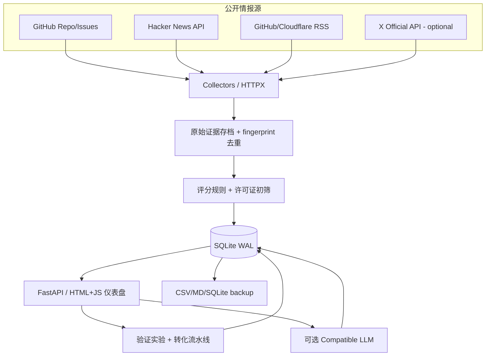

# Opportunity OS · 技术架构与演进约束

## 数据流

## 模块边界

- **Collectors**：仅获取有真实公开来源的材料；返回统一记录。失败单独记日志，不回填虚假对象；实时数据已取回并持久化，后续网络失败不会清除旧数据。
- **Scoring**：基于公开观测值和可解释的固定权重计算**验证优先级**。类别能力判断和经济报价属于假设，不能被称为实际市场价格。
- **DB**：按来源 ID 或 URL 的 SHA-256 fingerprint 去重。采集快照按 UTC 日保存；候选人工状态、客户与产品方案、实验记录在后续采集时保持不变。
- **API**：默认仅监听本机，不支持公网认证；所有可写接口需在投入线上使用前增加身份认证、CSRF/权限和审计日志。
- **Frontend**：无前端构建依赖；所有来源文本使用 HTML escaping，外链协议白名单；没有插入任意 HTML 的功能。
- **AI**：仅可选调用用户配置的兼容 Chat Completions API，不抓取私有数据；输入仅限公开候选元信息，不包含客户沟通笔记或 API Key。
- **Scheduling**：内置后台线程适用于单进程部署，Windows Task Scheduler 适用于 UI 不持续运行的离线机器。不要同时启用多调度入口。

## 审查边界与风险

1. 不自动执行购买、收费、上传、外发推广等敏感动作。
2. 不把 SaaS 演示价 / LLM 生成的报价 / GitHub 星数认定为真实成交。
3. LICENSE=UNKNOWN 默认为需要人工核查；商标、数据许可、依赖义务需单独审查。
4. X 仅可选官方 API；避免共享 Key、越权代理或绕过风控采集。
5. 保留上次成功快照，不会在 API 失败时绘制模拟实时数据。
6. 当前 SQLite 适合单机；接入多用户/多进程并发后应迁移到 PostgreSQL 并增加消息队列与分布式锁。

## 可量化的产品 KPI

- 机会采集：每日新增 / 每源失败率 / 重复率 / 新项目 7 日热度变化。
- 需求验证：接触人数 / 有效回复 / 付费试单 / 拒绝原因。
- 交付经营：测试报价 / 实际成本 / 真实收入 / 工时贡献 / 复购率。
- 数据质量：来源证据完整性 / 发布日期覆盖 / License UNKNOWN 占比 / 手工记录比率。

## UI 设计规范

- 浅色优先、低饱和绿色、明确的一级/二级层级；避免无意义渐变、炫光和复杂动画。
- 核心信息优先：评分、来源、阶段、客户、验收与真实结果；每个模块必须有空白态和失败态。
- 侧栏显示导航、操作集中在顶部；详情抽屉不破坏当前筛选状态；移动端侧栏可展开。
- 通过 CSS 自定义变量实现深色主题，不加载外部字体文件，组件保留键盘焦点反馈。
- 后续可按 React/Vue 升级，但必须保持 API 协议与 SQLite 数据迁移向后兼容。
